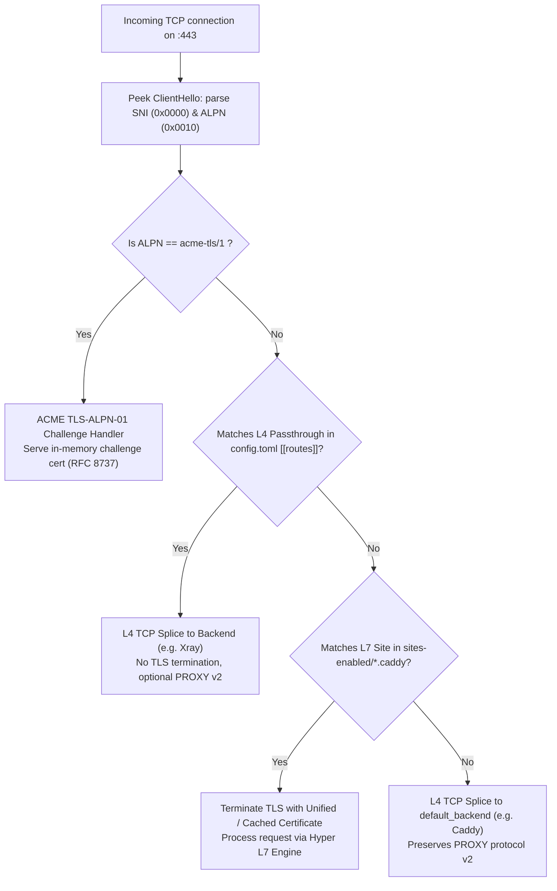

# Hybrid Reverse Proxy & Auto-SSL Architecture Plan (Phase 2)

## 1. Context, Goal & Evolutionary Strategy

### 1.1 Context within Project Roadmap
- **Phase 1 (MVP, documents 00–05)**: Implements the baseline L4 SNI router on `:443` without TLS termination. Slices raw TCP streams between Xray and an external Caddy instance (`default_backend`) with PROXY protocol v2.
- **Phase 2 (This document)**: Evolves PenikProxy into a hybrid L4/L7 reverse proxy with native Caddyfile parsing, embedded Auto-SSL (ACME v2 via DNS-01 and TLS-ALPN-01), static file serving, and zero-downtime hot reloading.

### 1.2 Coexistence, Migration & Rollback Strategy
- **Coexistence**: The existing `default_backend` (e.g., Caddy on `127.0.0.1:8444`) is **retained**. It acts as the catch-all fallback and migration bridge.
- **Gradual Migration**: Sites can be migrated one-by-one from the external Caddy into PenikProxy's `sites-enabled/`. If a site is not found in `sites-enabled/`, traffic seamlessly falls back to `default_backend`.
- **Zero Overhead Toggle**: If `sites_dir` is not configured in `config.toml`, PenikProxy operates strictly in Phase 1 pure L4 mode with zero L7 runtime overhead.
- **Rollback Safety**: If any migrated site experiences issues, removing or renaming its `.caddy` file triggers a hot-reload that immediately routes that domain's SNI back to `default_backend = "caddy"` via L4 pass-through.

---

## 2. Traffic Flow & Connection Pipeline

Every incoming connection on `:443` is processed through a deterministic decision tree:



### Protocol Parser Updates (`src/sni.rs`)
The current `src/sni.rs` only extracts extension `0x0000` (SNI). In Phase 2, `src/sni.rs` is expanded to:
1. Parse TLS extension `0x0000` (`server_name`).
2. Parse TLS extension `0x0010` (`application_layer_protocol_negotiation` — ALPN).
3. If ALPN list contains `acme-tls/1`, flag connection for the ACME challenge handler before any routing decisions.

### Optional HTTP Port 80 Listener
While Port 80 is **not** required for SSL issuance (due to DNS-01 and TLS-ALPN-01), PenikProxy supports an optional global configuration:
```toml
http_listen = "0.0.0.0:80" # optional, disabled by default
```
When enabled, all requests on `:80` receive an immediate `301 Moved Permanently` redirect to `https://{host}{uri}`.

---

## 3. Unified Auto-SSL Engine

### 3.1 Consolidated Multi-Domain SAN Strategy
Let's Encrypt permits up to **100 Subject Alternative Names (SANs)** per single certificate (per Let's Encrypt Certificate Limits specification).

1. **Domain Extraction**: On startup and reload, PenikProxy scans all sites in `sites-enabled/`.
2. **Clustering**: For each site, extracts the fully-qualified domain name (FQDN), groups by apex domain (e.g., `example.org`, `example.com`), and generates wildcard pairs:
   - Group 1: `example.org` and `*.example.org`
   - Group 2: `example.com` and `*.example.com`
3. **Consolidation**: Consolidates all groups into **one unified multi-SAN certificate order** if total SAN count $\le 100$.
4. **Instant Subdomains**: Any new subdomain added in `sites-enabled/` matching an existing wildcard is immediately valid without requesting a new certificate.

### 3.2 Challenge Selection per Identifier
Within a multi-SAN ACME order (RFC 8555), Let's Encrypt generates one authorization object per identifier:
- **Wildcard identifiers (`*.domain.com`)**: **Must** be solved via `DNS-01`. PenikProxy uses Cloudflare API to provision `_acme-challenge` TXT records.
- **Apex/Single identifiers (`domain.com`)**: Solved via `DNS-01` if Cloudflare credentials are configured; otherwise solved via `TLS-ALPN-01` on `:443`.

### 3.3 Blast Radius & Fault Partitioning
*Risk*: In a single multi-SAN order, if one domain fails verification (e.g. DNS propagation timeout or misconfigured zone), Let's Encrypt fails the entire order.
*Mitigation*:
- **Pre-flight DNS Check**: Before submitting the ACME challenge response, PenikProxy verifies TXT propagation locally against public DNS resolvers (`1.1.1.1`, `8.8.8.8`).
- **Partitioning Fallback**: If a consolidated order fails authorization, the engine automatically partitions the order into **per-apex certificates** (`example.org` + `*.example.org` as Order A, `example.com` + `*.example.com` as Order B). A failure in one apex domain does not block issuance for other domains.

### 3.4 ACME Provider, Staging & Security
- **Cloudflare Limitation**: DNS-01 automation currently requires domains to be managed on Cloudflare. This limitation is explicitly documented.
- **Let's Encrypt Staging**: Configurable via `[tls] staging = true`, switching directory URL to `https://acme-staging-v02.api.letsencrypt.org/directory` to test without consuming production rate limits.
- **Key Persistence & Permissions**: ACME account keys and private keys are saved under `storage_dir` with Unix file permissions strictly set to `0600` (read/write only by the proxy owner).
- **OCSP Stapling**: Deferred to post-Phase 2 to maintain implementation focus.

---

## 4. Supported Caddyfile Subset & Semantics

PenikProxy implements a strict, predictable subset of Caddyfile directives.

### 4.1 Strict Fail-Fast Policy
To prevent silent misconfigurations, **any unknown directive, unclosed block, or invalid argument causes configuration validation to fail fast** with the exact filename, line, and column reported. The server will refuse to start or refuse to apply the reload.

### 4.2 Supported Directives Matrix

| Directive | Syntax | Semantics |
| :--- | :--- | :--- |
| `reverse_proxy` | `reverse_proxy <upstreams...>` | Proxies HTTP requests to TCP (`127.0.0.1:3000`) or Unix socket (`unix//run/app.sock` and `unix:///run/app.sock`). Automatic HTTP/1.1 and H2 upstream pooling. Automatic WebSocket upgrade tunneling. Injects `X-Forwarded-For`, `X-Forwarded-Proto`, `X-Forwarded-Host`, `X-Real-IP`, `Host`. |
| `root` | `root * <path>` | Sets the document root path for static files. |
| `file_server` | `file_server [browse]` | Serves static assets from `root`. Streams file with chunked/content-length encoding, determines MIME via `mime_guess`. Returns `404` if not found. |
| `try_files` | `try_files <files...> <fallback>` | Checks file existence sequentially; rewrites request path to the first match or falls back to a named matcher / route. |
| `handle` | `handle [<matcher>] { ... }` | Mutually exclusive routing block. |
| `redir` | `redir [<matcher>] <target> [code]` | Issues HTTP redirect (default `302`, or `301`, `307`, `308`). |
| `rewrite` | `rewrite [<matcher>] <target>` | Internal URL path rewrite. |
| `header_up` | `header_up [+|-]<name> [value]` | Modifies upstream request headers. |
| `header_down`| `header_down [+|-]<name> [value]` | Modifies downstream response headers. |

### 4.3 Semantic Examples

#### Example 1: Reverse Proxy with Unix Socket & TCP Upstreams
```caddyfile
ad1.example.org {
    reverse_proxy 127.0.0.1:3001
}

ad2.example.org {
    # Supports both Caddy unix// and URI unix:/// format
    reverse_proxy unix//run/chat/ad2.sock
}
```

#### Example 2: Static File Server
```caddyfile
example.org {
    root * /var/www/example
    file_server
}
```

#### Example 3: Static Files with Reverse Proxy Fallback (SPA / API)
In Caddy semantics, `file_server` alone emits 404 for missing files. To properly fall back to a proxy, PenikProxy uses `handle` or `try_files`:
```caddyfile
example.com {
    root * /var/www/example
    # Route requests matching static files to file_server; everything else to backend
    @static file
    handle @static {
        file_server
    }
    handle {
        reverse_proxy 127.0.0.1:8080
    }
}
```

---

## 5. Hot Reload & Concurrency Architecture

### 5.1 Atomic Swapping
Configuration and active certificates are managed behind an `ArcSwap<RuntimeConfig>`:
- When a reload is triggered, PenikProxy compiles the new draft configuration in isolation (parses Caddyfiles, verifies syntax, checks upstream socket permissions).
- **If validation fails**: An error is logged with line numbers; the active configuration remains 100% active. Existing and incoming connections suffer zero interruption.
- **If validation succeeds**: The active pointer is swapped atomically using `ArcSwap::store`. Active in-flight requests finish on their existing snapshot; new connections immediately use the updated configuration.

### 5.2 Triggers & Debounce
1. **SIGHUP Handler**: Unix signal triggers immediate reload and logs outcome.
2. **Filesystem Watcher (`notify`)**: Monitors `config.toml` and `sites-enabled/`. Includes a **500ms debounce buffer** to coalesce burst write/rename/flush events from text editors into a single reload pass.

---

## 6. Rust Crates & Module Architecture

### 6.1 Verified Dependencies
```toml
[dependencies]
# TLS & Crypto
rustls = "0.23"
tokio-rustls = "0.26"
rustls-pki-types = "1"
rcgen = "0.14"

# HTTP & Networking
hyper = { version = "1", features = ["full"] }
hyper-util = { version = "0.1", features = ["full"] }
tower = { version = "0.5", features = ["util"] }
mime_guess = "2"
http-body-util = "0.1"

# ACME & REST
instant-acme = "0.8"
reqwest = { version = "0.13", default-features = false, features = ["rustls-tls", "json"] }

# State, Reload & Watching
arc-swap = "1"
notify = "8"

# (Future extension: Lua scripting engine)
# mlua = { version = "0.12", features = ["lua54", "async", "vendored"] }
```

### 6.2 Module Breakdown
- `src/caddyfile/`:
  - `lexer.rs`: Tokenizer with exact line/column tracking.
  - `parser.rs`: AST parser enforcing the supported directive subset and fail-fast validation.
  - `matcher.rs`: Path, extension, and wildcard host matching.
- `src/acme/`:
  - `client.rs`: RFC 8555 client wrapping `instant-acme`.
  - `dns_cloudflare.rs`: REST client for Cloudflare DNS record management.
  - `alpn_challenge.rs`: Ephemeral self-signed certificate generator for `acme-tls/1`.
  - `cluster.rs`: Apex domain clustering and multi-SAN consolidation logic.
  - `store.rs`: Disk persistence with `0600` key permissions.
- `src/l7/`:
  - `service.rs`: Hyper service dispatcher handling `handle`, `try_files`, `redir`.
  - `proxy.rs`: Reverse proxy upstream forwarder with WebSocket upgrade support.
  - `static_files.rs`: Static asset streaming with MIME guessing.
- `src/tls/`:
  - `resolver.rs`: Custom `rustls::server::ResolvesServerCert` matching SNI against in-memory certs.
- `src/watcher.rs`:
  - SIGHUP and 500ms debounced filesystem watcher.
- `src/sni.rs`:
  - Extended to parse both SNI (0x0000) and ALPN (0x0010).

---

## 7. Implementation Roadmap & Test Plan (Stages)

Each stage within Phase 2 includes parallel unit/integration tests with explicit Definition of Done (DoD).

### Stage 1: Caddyfile Parser & Domain Clustering
- **Tasks**: Implement `lexer.rs`, `parser.rs`, and `cluster.rs`.
- **Parallel Tests**:
  - Unit tests for tokenizer (comments, quoted strings, block nesting).
  - Validation test: unknown directive fails with exact line number.
  - Clustering test: `[ad1.example.org, ad2.example.org, example.org, ad1.example.com]` correctly clusters into `[example.org, *.example.org, example.com, *.example.com]`.
- **DoD**: All unit tests pass; CLI command `--validate-sites` validates `sites-enabled/`.

### Stage 2: Native ACME Engine (DNS-01 & TLS-ALPN-01)
- **Tasks**: Cloudflare DNS API client, `acme-tls/1` challenge responder, multi-SAN order manager, partition fallback.
- **Parallel Tests**:
  - Mock ACME server / staging test: issuance of multi-SAN certificate.
  - Fallback test: simulated failure of 1 apex domain causes partition into separate orders.
  - Permission test: verify private keys are created with `0600` permissions.
- **DoD**: Certificate issuance succeeds on Let's Encrypt Staging; certs stored and reloadable.

### Stage 3: L7 Reverse Proxy & Static Server
- **Tasks**: Hyper v1 integration, WebSocket upgrade tunnel, static file handler with `try_files`.
- **Parallel Tests**:
  - Integration test: HTTP/1.1 and H2 upstream request forwarding with `X-Forwarded-*` headers.
  - WebSocket echo test: bi-directional upgrade streams cleanly without drop.
  - Static file test: MIME guessing, path traversal rejection (`/../etc/passwd` $\to$ 403/404).
- **DoD**: End-to-end HTTP requests and WebSockets work across TLS termination.

### Stage 4: Hybrid Integration & Hot Reload
- **Tasks**: Update `src/sni.rs` for ALPN; integrate L7 routing into `relay.rs`; SIGHUP and `notify` debounce.
- **Parallel Tests**:
  - SNI/ALPN test: `acme-tls/1` routes to challenge; `xray` routes to L4; `site` routes to L7; unknown routes to configured `default_backend`.
  - Hot reload test: modifying a site config applies changes without dropping existing TCP connections.
  - Invalid config reload test: corrupted site file is rejected, previous config remains active.
- **DoD**: Complete end-to-end test matrix passes; clean rollback verified.
