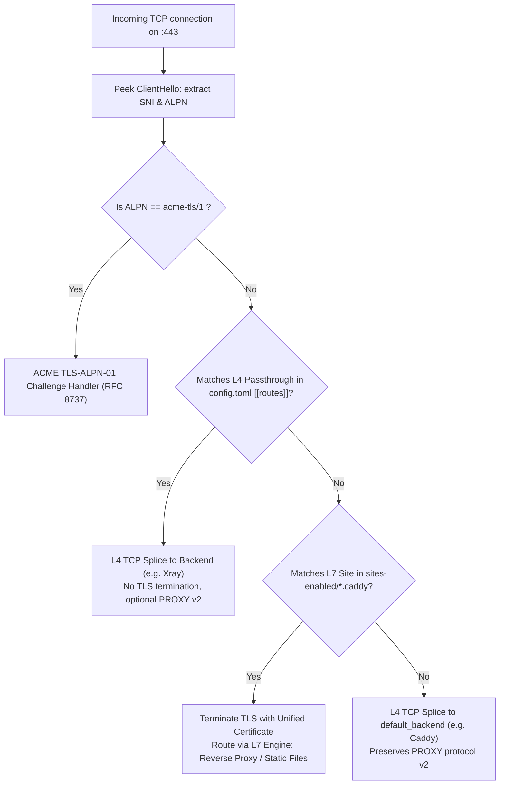

# Hybrid Reverse Proxy & Auto-SSL Architecture Plan

## 1. Executive Summary

PenikProxy evolves from a lightweight Layer-4 SNI multiplexer into a full-featured hybrid reverse proxy with native Caddyfile syntax support and built-in Auto-SSL (ACME v2 with DNS-01 and TLS-ALPN-01 challenges).

Key differentiators:
- **Zero External Dependencies**: Operates as a single standalone Rust binary. No external runtime tools (`certbot`, `acme.sh`, Python) required.
- **Unified Multi-SAN Certificate Optimization**: Aggregates all domains and wildcard clusters from all configured sites into a **single consolidated certificate** (up to 100 SANs per Let's Encrypt specifications), eliminating multiple ACME orders and avoiding rate limits.
- **Hybrid L4 / L7 Coexistence**: Preserves high-performance raw TCP pass-through (e.g. for Xray / VLESS Reality) while terminating TLS and proxying HTTP/WebSocket or serving static files for configured web sites.
- **Caddyfile Compatibility**: Native parsing of standard Caddyfile site definitions in `sites-enabled/`.
- **Zero-Downtime Hot Reload**: Automatic file watching on `sites-enabled/` and `SIGHUP` support.

---

## 2. Routing Hierarchy & Traffic Flow

Every incoming connection on `:443` undergoes SNI inspection:



### Precedence Order
1. **ACME ALPN Probe**: Handled immediately if `acme-tls/1` is requested during an active certificate order.
2. **L4 Passthrough (`config.toml`)**: If the SNI matches a route in `[[routes]]` (e.g., `studio.iuharin.ru -> xray`), connection is spliced directly at TCP level without decrypting.
3. **L7 Sites (`sites-enabled/*.caddy`)**: If the SNI matches a configured site or wildcard, PenikProxy terminates TLS using the in-memory certificate and processes the HTTP/1.1 or HTTP/2 request.
4. **Fallback (`default_backend`)**: If no rule matches, routes to `default_backend` (with optional PROXY protocol v2).

---

## 3. Unified Auto-SSL Engine

### 3.1 Consolidated Multi-Domain SAN Strategy
Instead of issuing individual certificates for each site or subdomain (which triggers Let's Encrypt rate limits and multiplies renewal overhead):
1. PenikProxy scans all sites in `sites-enabled/` on startup and reload.
2. Extracts all fully-qualified domain names (FQDNs), e.g., `ad1.slavchat.ru`, `ad2.slavchat.ru`, `slavchat.ru`, `ad1.penik.ru`.
3. Derives base/apex domains and wildcard entries:
   - `slavchat.ru` + `*.slavchat.ru`
   - `penik.ru` + `*.penik.ru`
4. Requests **one unified certificate** containing all base domains and wildcards in its Subject Alternative Name (SAN) list.
5. **Instant Subdomain Availability**: Any future subdomain added under an existing apex wildcard works immediately with zero certificate issuance delay.

### 3.2 ACME Validation Methods
- **DNS-01 (Wildcard & Apex)**:
  - Communicates directly with Cloudflare DNS API (RFC 8555 + Cloudflare REST API).
  - Credentials configured globally in `config.toml` (`cloudflare_token` or `cloudflare_credentials = "/etc/penik/cloudflare.ini"`).
  - Automatically provisions `_acme-challenge` TXT records, polls propagation, completes order, and deletes temporary TXT records.
- **TLS-ALPN-01 (RFC 8737)**:
  - For non-wildcard domains without Cloudflare DNS credentials.
  - Validates entirely over port 443 during TLS handshake using the `acme-tls/1` protocol extension.
  - Requires no port 80 and no DNS credentials.
- **Manual / External Fallback**:
  - Supports explicit certificate paths (`tls /path/to/cert.pem /path/to/key.pem`) or shell commands (`tls cmd "..."`).

### 3.3 Storage & Renewal Lifecycle
- Certificate and private key stored under `storage_dir` (e.g., `/var/lib/penik-proxy/certs/unified.pem` and `unified.key`).
- In-memory hot-swapping via `ArcSwap<rustls::ServerConfig>`.
- Background renewal worker executes daily, initiating ACME re-issuance when certificate expiration is within 30 days.

---

## 4. Configuration Model

### 4.1 Global Configuration (`/etc/penik-proxy/config.toml`)
```toml
listen = ["0.0.0.0:443", "[::]:443"]
strict_listen = true
sites_dir = "/etc/penik-proxy/sites-enabled"

[tls]
email = "admin@slavchat.ru"
storage_dir = "/var/lib/penik-proxy/certs"
cloudflare_credentials = "/etc/penik/cloudflare.ini"
# cloudflare_token = "..." # alternative direct token
renew_days_before = 30

# L4 Passthrough routes (unchanged format)
[[routes]]
sni = "studio.iuharin.ru"
backend = "xray"

[backends.xray]
addr = "127.0.0.1:8443"
send_proxy_protocol = false

default_backend = "caddy"
[backends.caddy]
addr = "127.0.0.1:8444"
send_proxy_protocol = true
```

### 4.2 Site Configurations (`/etc/penik-proxy/sites-enabled/*.caddy`)
Standard Caddyfile format with no mandatory TLS blocks:

#### Example 1: Reverse Proxy with Auto-WebSockets (`sites-enabled/chat.caddy`)
```caddyfile
ad1.slavchat.ru {
    reverse_proxy 127.0.0.1:3001
}

ad2.slavchat.ru {
    reverse_proxy unix:///run/chat/ad2.sock
}
```

#### Example 2: Static File Serving (`sites-enabled/main.caddy`)
```caddyfile
slavchat.ru {
    root * /var/www/slavchat
    file_server
}
```

#### Example 3: Mixed Static + Proxy Fallback (`sites-enabled/portal.caddy`)
```caddyfile
penik.ru {
    root * /var/www/penik
    file_server
    reverse_proxy 127.0.0.1:8080
}
```

---

## 5. L7 HTTP Engine Details

- **HTTP Protocols**: HTTP/1.1 and HTTP/2 (ALPN `h2`, `http/1.1`).
- **Proxy Headers**: Automatically appends and standardizes:
  - `X-Forwarded-For` (appends client IP)
  - `X-Forwarded-Proto` (`https`)
  - `X-Forwarded-Host` (requested Host)
  - `X-Real-IP` (direct remote IP)
  - `Host` (preserved or normalized)
- **WebSockets**: Detects `Upgrade: websocket` and `Connection: Upgrade`, completes 101 Switching Protocols response, and performs bidirectional byte streaming between client and backend.
- **Static File Serving**:
  - Resolves sanitized relative path against `root`.
  - Determines MIME type using `mime_guess`.
  - Supports `GET` and `HEAD` methods, returns `404 Not Found` or `403 Forbidden` if path is outside root.

---

## 6. Rust Implementation Architecture

### 6.1 Crate Dependencies
```toml
# TLS & Crypto
rustls = "0.23"
tokio-rustls = "0.26"
rustls-pki-types = "1"
rcgen = "0.13"

# HTTP Engine
hyper = { version = "1", features = ["full"] }
hyper-util = { version = "0.1", features = ["full"] }
http-body-util = "0.1"
tower = { version = "0.5", features = ["util"] }
mime_guess = "2"

# ACME & Network
instant-acme = "0.7"
reqwest = { version = "0.12", default-features = false, features = ["rustls-tls", "json"] }

# Concurrency & Hot Reload
arc-swap = "1"
notify = "6"
```

### 6.2 Module Layout
- `src/caddyfile/`:
  - `lexer.rs`: Tokenizes Caddyfile syntax (blocks, directives, arguments).
  - `parser.rs`: Builds abstract configuration representation (`SiteConfig`, `Directive`).
  - `matcher.rs`: Domain & wildcard matching logic (`*.domain.com`).
- `src/acme/`:
  - `client.rs`: ACME v2 RFC 8555 communication with Let's Encrypt / ZeroSSL.
  - `dns_cloudflare.rs`: Cloudflare API client for TXT record creation and deletion.
  - `alpn_challenge.rs`: In-memory certificate generation for `acme-tls/1` verification.
  - `cluster.rs`: Domain extractor that clusters all sites into root domains + wildcards for the unified multi-SAN certificate.
  - `store.rs`: Reads and writes certificate chains and private keys to disk.
- `src/l7/`:
  - `server.rs`: Accepts decrypted TLS streams and binds Hyper HTTP/1.1 + H2 service.
  - `proxy.rs`: Hyper client for upstream reverse proxying, connection reuse, and WebSocket tunneling.
  - `static_files.rs`: Static asset streaming with MIME resolution.
- `src/tls/`:
  - `resolver.rs`: Custom `rustls::server::ResolvesServerCert` implementation with hot-reloading support.
- `src/watcher.rs`:
  - Listens for `SIGHUP` and monitors `sites-enabled/` and `config.toml` changes using `notify`.
- `src/relay.rs`:
  - Updates routing logic to branch between L4 passthrough, L7 TLS termination, and default backend.

---

## 7. Implementation Roadmap

### Phase 1: Caddyfile Parser & Configuration Pipeline
- Implement Caddyfile lexer & AST parser (`sites-enabled/*.caddy`).
- Support `reverse_proxy`, `root`, `file_server`, and basic block directives.
- Implement domain clustering logic to generate unified SAN list.

### Phase 2: Native ACME Engine (DNS-01 & TLS-ALPN-01)
- Implement Cloudflare DNS-01 API client (TXT record create, poll, delete).
- Implement TLS-ALPN-01 challenge generator (`acme-tls/1`).
- Implement ACME order manager to request and save the unified multi-SAN certificate.
- Implement background renewal scheduler.

### Phase 3: L7 HTTP Reverse Proxy & Static Server
- Integrate `tokio-rustls` with dynamic certificate resolver.
- Implement Hyper v1 reverse proxy with automatic header injection and WebSocket upgrade tunneling.
- Implement static file server handler.

### Phase 4: Hybrid Integration & Hot Reload
- Update `relay.rs` to dispatch connections to the L7 engine when SNI matches an L7 site.
- Implement SIGHUP listener and `notify` filesystem watcher.
- Validate zero-downtime reconfiguration.

### Phase 5: Verification & Documentation
- Comprehensive test suite covering Caddyfile parsing, wildcard resolution, WebSocket proxying, and SNI routing.
- Update `PROJECT_MAP.md` and user documentation.
